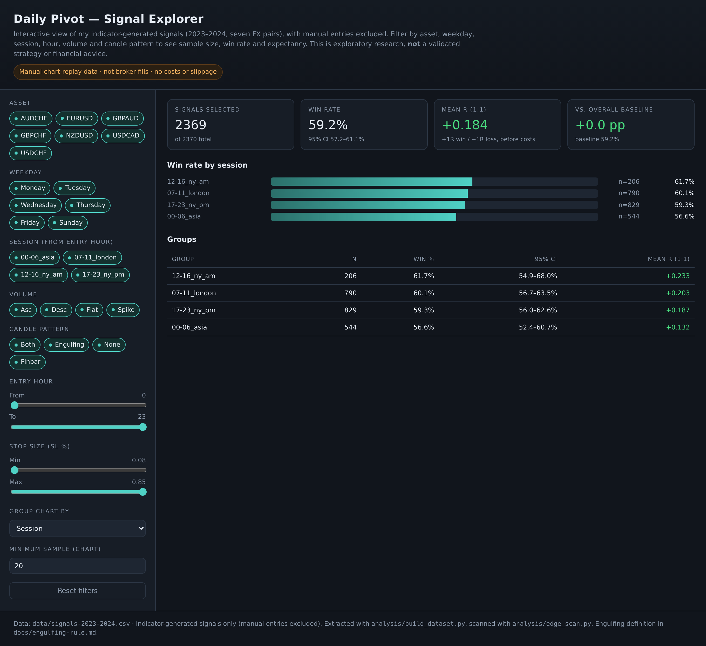

# Daily Pivot Liquidity Strategy — TradingView (Pine Script v6)

An intraday forex system I built around **previous-day liquidity sweeps**, with a
Supertrend trend filter, an ATR-based stop, and a fixed risk-reward target. It has
two parts: an indicator that marks the sweeps and an optional strategy for replay
and backtesting.

> **Status:** personal research project. I recorded the signals and outcomes by
> hand during chart replay, not from a live broker, and I have not validated the
> system as a profitable edge. I share it as a study of a discretionary intraday
> approach, not as trading advice.

## Background

This is a personal project I built on my own, before I had formal data training.
I did the exploratory analysis later, and it is where I put into practice what
I've been studying in the **Tecnicatura Universitaria en Gestión y Análisis de
Datos en Organizaciones (FCE, UBA)**:

- **Taller de Programación para el Análisis de Datos** (in progress) — Python,
  pandas and NumPy: loading, cleaning and shaping the data.
- **Métodos Predictivos para la Gestión** (in progress) — sampling and inference,
  data preprocessing, linear regression and time series.
- **Laboratorio de Métodos Cuantitativos Aplicados a la Gestión** (approved) —
  quantitative modeling in Python.

The analysis is where that shows up: I built the tidy signal table with pandas,
then estimated confidence intervals and tested subgroup win rates against a
baseline. The sampling and inference unit is also why I flag the limits honestly —
this is a small, hand-labelled, non-random sample. On top of what I have learned
so far, I added false-discovery-rate control so the subgroup search stays honest.

I understand and can reproduce every step of this pipeline; it is not a black box.
The strategy idea and the manual replay are entirely my own, and no course
material is included in this repository.

## How it works

- Every session I track the **previous day's high and low** and draw them as
  lines.
- A **sweep** is when price trades through one of those levels and closes back on
  the other side: it takes out the prior high and closes back below (short
  setup), or it takes out the prior low and closes back above (long setup).
- I only take sweeps inside a configurable session window (default 09:30–16:00).
- A **Supertrend** (ATR length 10, factor 3.0) filters direction: longs only in an
  uptrend, shorts only in a downtrend. The filter can be turned off.
- The **stop** sits at the signal close ± (ATR(13) × 2.0); the **target** is a
  multiple of that risk (default 2R).
- Position size is a fixed percentage of account equity per trade (default 1%).

## Files

- [`indicators/daily-pivot-indicator.pine`](indicators/daily-pivot-indicator.pine) —
  pivots, sweeps, Supertrend, ATR stop labels, and alerts.
- [`strategies/daily-pivot-strategy.pine`](strategies/daily-pivot-strategy.pine) —
  the strategy version (entries, stop, target, risk sizing).
- [`docs/engulfing-rule.md`](docs/engulfing-rule.md) — the deterministic
  candle-pattern rule I want to test next.
- [`data/signals-2023-2024.csv`](data/signals-2023-2024.csv) — a clean, minimal
  sample of my replayed signals.
- [`analysis/`](analysis/) — the scripts that build the sample and run the
  exploratory scan.
- [`dashboard/`](dashboard/) — the interactive signal explorer.

## Data and interactive dashboard

I published a clean, minimal slice of the signals the indicator generated
(2023–2024, seven FX pairs; manual entries excluded) so the analysis can be
reproduced. It keeps only: asset, date, weekday, entry hour, volume, candle
pattern, stop size, and the win/loss result — no account values, position sizes,
or personal execution notes.

The [interactive dashboard](dashboard/) lets you filter that sample by asset,
weekday, session, entry hour, volume, and candle pattern, and see sample size,
win rate, a 95% interval, and 1:1 expectancy update live. It is a static page and
is served through GitHub Pages:

**Live dashboard:** https://danino99.github.io/daily-pivot-strategy/dashboard/

Because the published table is deliberately minimal, it drops the execution
flags and the 2:1 outcome, so it shows 1:1 expectancy only and cannot separate
my delayed manual confirmations or manual stop changes. It is an exploration
tool, not a validated result.

## Main inputs

| Input | Default | Purpose |
| --- | --- | --- |
| Session | `0930-1600` | Valid entry window. |
| Max line age (days) | `30` | Drops stale pivot lines. |
| Date range | `2022-01-01` to `2022-12-31` | Limits the indicator/strategy to a replay window. |
| Supertrend ATR / factor | `10` / `3.0` | Trend filter. |
| ATR stop length / multiplier | `13` / `2.0` | Stop distance. |
| Risk per trade | `1.0%` | Equity risk per entry. |
| Take-profit R:R | `2.0` | Target as a multiple of risk. |

## Alerts

The indicator publishes alerts for immediate pivot breaks, sweep entries
(buy/sell, with the stop level in the message), and Supertrend direction changes.
I included the stop in the entry messages so they can be forwarded to a webhook
or journal.

## Backtest review (exploratory)

I replayed the signals by hand across seven FX pairs over 2023–2025 and recorded
the outcomes. The base plan used the indicator's ATR stop with 1:1 reward:risk,
and I separately replayed a 2:1 target. These are aggregate, manually labelled
results — not broker fills, and without slippage or full exit timestamps.

- On the **strict mechanical cohort** (indicator signals only, excluding my
  manual confirmations and manual stops), the base 1:1 win rate was about
  **53.5%** across 2,139 signals: roughly breakeven after my estimated
  spreads, commission, and swap. I do not present it as a proven edge.
- The only feature that survived multiple-comparison control was a
  hand-recorded **Engulfing** candle tag: about **78.8%** wins in the
  indicator-signal cohort (198 signals) and **72.7%** in the stricter cohort
  (55 signals), stable across 2023 and 2024 with a small 2025 holdout.
- Because I tagged Engulfing by eye, it needs a deterministic definition and an
  independent out-of-sample test before it means anything. That definition is in
  [`docs/engulfing-rule.md`](docs/engulfing-rule.md); I have not wired it into
  the code yet.

## What I take away

My own read after watching the indicator over these years:

- It often fires **several signals in a row**. Taken mechanically, without an
  extra filter or some judgment, that can wear down its effectiveness.
- It seems to work better in **range-bound, low-trend conditions** — phases of
  accumulation or distribution where price oscillates — than in **strong trends**,
  up or down, where it produces more false signals, sometimes back-to-back.
- I have not modeled a **cap on simultaneous open positions**, a **rollover
  filter**, or the other controls that exist in my original workflow; those are
  outside this public sample.

These are my observations from replay, not measured conclusions.

## Limitations

- The outcomes are manual chart-replay labels, not live execution.
- The default inputs target a 2022 replay; adjust the date range and session for
  your own period.
- The Engulfing rule is proposed but not yet implemented in the strategy.
- I make no profitability, drawdown, or capital-impact claims.

## Use it

In TradingView: open the Pine Editor, paste the file, save, and add it to a
chart. Use the indicator for visual replay and alerts, and the strategy for the
Strategy Tester over the matching date range. Set the session, date range, and
risk inputs to suit the replay.

## Reuse

All rights reserved. No license is granted: I'm sharing this project for viewing
only, and reuse or redistribution requires my written permission. Nothing here is
financial advice.
